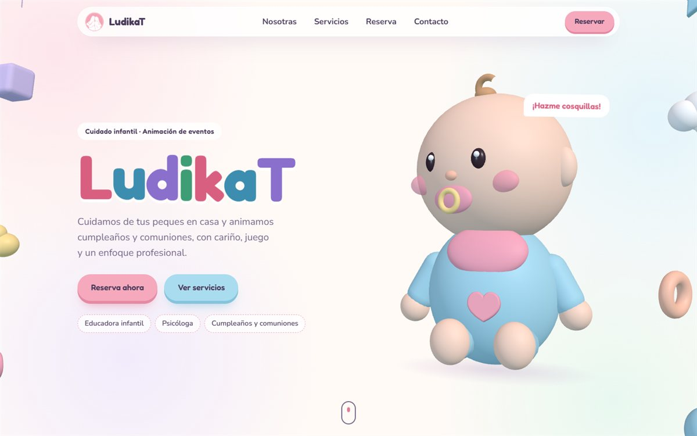
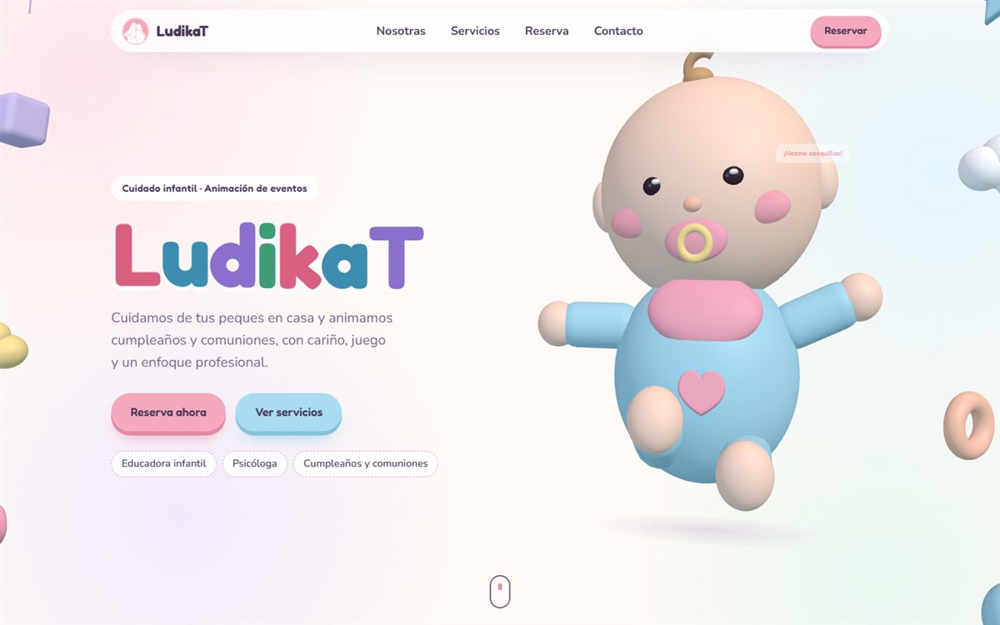
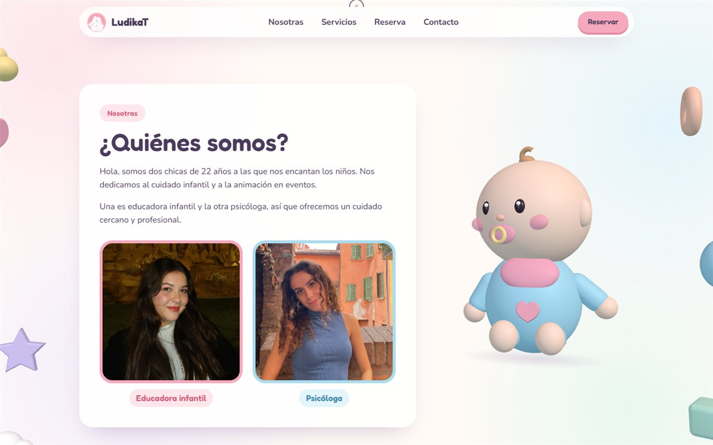
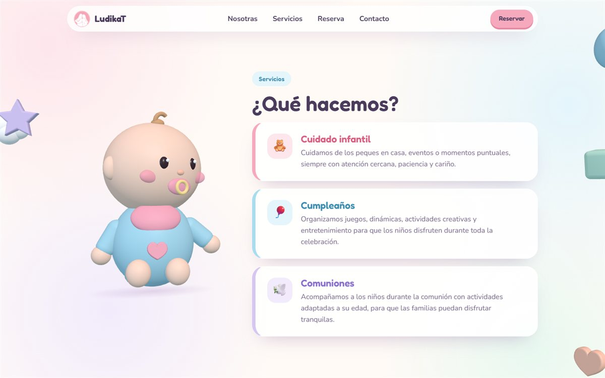
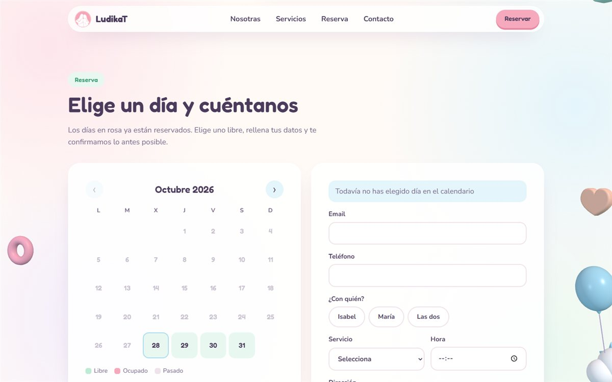
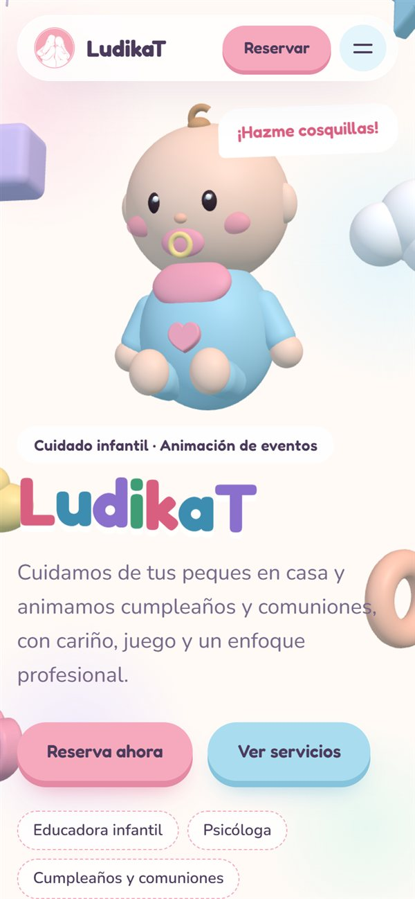

<div align="center">


# LudikaT

Web de **LudikaT**, cuidado infantil y animación de cumpleaños y comuniones a cargo de una educadora infantil y una psicóloga. Tiene una landing 3D en tonos pastel, un calendario de reservas conectado a Supabase y un panel privado para las cuidadoras.

🌐 **En producción:** https://ludika-t.vercel.app/



</div>

## Capturas

<table>
  <tr>
    <td width="50%"></td>
    <td width="50%"></td>
  </tr>
  <tr>
    <td align="center"><sub>Al hacerle cosquillas, el bebé salta y da una vuelta</sub></td>
    <td align="center"><sub>Nosotras: quiénes somos</sub></td>
  </tr>
  <tr>
    <td></td>
    <td></td>
  </tr>
  <tr>
    <td align="center"><sub>Servicios: el bebé cambia de lado al hacer scroll</sub></td>
    <td align="center"><sub>Reserva: calendario y elección de cuidadora</sub></td>
  </tr>
</table>

<p align="center">
  <br />
  <sub>Versión móvil</sub>
</p>

## Qué incluye

- **Bebé 3D interactivo**, hecho solo con código (sin modelos ni texturas). Respira, parpadea, sigue el ratón con la mirada y saluda. Al hacerle clic salta, da una vuelta y suelta corazones y estrellas. Mientras haces scroll va saltando de sección en sección.
- **Juguetes flotantes** de fondo con parallax: globos, estrellas, bloques, patitos, nubes y aros.
- **Secciones:** portada, Nosotras, Servicios, Reserva, Contacto y pie de página.
- **Reservas:** el calendario marca los días libres, ocupados y pasados. El cliente rellena sus datos y elige con quién quiere la reserva: *Isabel*, *María* o *Las dos*. La reserva se guarda en Supabase.
- **Aviso por correo:** cada reserva nueva envía un email a Isabel y a María con todos los datos, usando [Resend](https://resend.com).
- **Panel de cuidadoras** en `/admin`, para ver, filtrar y borrar reservas.
- **Versión sin 3D:** si el navegador no tiene WebGL o el usuario tiene activado "reducir movimiento", se muestra el logo en lugar de la escena 3D.

## Stack

| Tecnología | Uso |
|---|---|
| [React 19](https://react.dev) + [Vite](https://vite.dev) | Interfaz y build (con React Compiler) |
| [React Three Fiber](https://r3f.docs.pmnd.rs) + [drei](https://drei.docs.pmnd.rs) + [Three.js](https://threejs.org) | Escena 3D |
| [React Router](https://reactrouter.com) | Rutas `/` y `/admin` |
| [Supabase](https://supabase.com) | Base de datos de reservas (tabla `Reservas`) |
| [Resend](https://resend.com) | Envío del correo de aviso |
| [Vercel](https://vercel.com) | Hosting y función serverless del correo |

## Empezar

Requisitos: Node.js 20 o superior.

```bash
npm install
npm run dev
```

La web queda en `http://localhost:5173`.

| Script | Qué hace |
|---|---|
| `npm run dev` | Servidor de desarrollo |
| `npm run build` | Build de producción en `dist/` |
| `npm run preview` | Sirve el build para probarlo |
| `npm run lint` | Revisa el código con ESLint |

> `npm run dev` no ejecuta la función de `api/`, así que en local el correo de aviso no se envía, aunque la reserva sí se guarda. Para probarlo todo junto, usa `npx vercel dev`.

## Variables de entorno

| Variable | Dónde | Para qué |
|---|---|---|
| `VITE_SUPABASE_URL` | `.env` y Vercel | URL del proyecto de Supabase |
| `VITE_SUPABASE_ANON_KEY` | `.env` y Vercel | Clave pública (*anon*) de Supabase |
| `RESEND_API_KEY` | **Solo Vercel** | Clave de Resend para enviar correos. Nunca le pongas el prefijo `VITE_`, porque entonces llegaría al navegador |
| `RESEND_FROM` | Vercel (opcional) | Remitente, p. ej. `LudikaT <reservas@tudominio.es>`. Hay que verificar el dominio en Resend. Si no se define, se usa `onboarding@resend.dev`, que solo puede enviar al email de la propia cuenta de Resend |

## Base de datos

Las reservas se guardan en la tabla `Reservas` de Supabase, con estas columnas: `cliente_email`, `telefono`, `cuidadora`, `servicio`, `fecha`, `hora`, `direccion` y `notas`.

La columna `cuidadora` se añadió con [supabase/add_cuidadora.sql](supabase/add_cuidadora.sql). Para montar un proyecto de Supabase nuevo, ejecuta ese script en *SQL Editor*.

## Correo de aviso

[api/notificar-reserva.js](api/notificar-reserva.js) es una función de Vercel que recibe la reserva y envía un correo a las dos cuidadoras. La respuesta va directa al email del cliente. Las direcciones de destino están en la constante `CUIDADORAS`, al principio del archivo.

## Estructura

```
├── api/
│   └── notificar-reserva.js   # Función de Vercel: correo de aviso con Resend
├── docs/screenshots/          # Capturas que se ven en este README
├── public/                    # Logos y fotos
├── supabase/
│   └── add_cuidadora.sql      # Columna "cuidadora" en la tabla Reservas
├── src/
│   ├── components/            # Navbar, Hero, About, Services, Booking, Calendar, Contact, Footer, AdminPanel
│   ├── hooks/useReveal.js     # Animación de aparición al hacer scroll
│   ├── pages/                 # Home y Admin
│   ├── services/supabase.js   # Cliente de Supabase
│   ├── three/                 # Escena 3D
│   │   ├── Scene.jsx          # Canvas, luces y posición del bebé en cada sección
│   │   ├── Baby.jsx           # El bebé y sus animaciones
│   │   ├── Hearts.jsx         # Corazones y estrellas al hacerle clic
│   │   ├── Toys.jsx           # Juguetes flotantes
│   │   ├── shapes.js          # Geometrías y medidas compartidas
│   │   └── support.js         # Comprueba si se puede mostrar el 3D
│   └── index.css              # Paleta pastel y todos los estilos
└── vercel.json                # Redirige todo a index.html salvo /api
```

## Personalizar

| Qué quieres cambiar | Dónde |
|---|---|
| Colores y tipografías | Variables `:root` en `src/index.css` |
| Textos de cada sección | `src/components/*.jsx` |
| Servicios | Array `SERVICES` en `src/components/Services.jsx` |
| Teléfonos de contacto | `src/components/Contact.jsx` |
| Correos que reciben los avisos | `CUIDADORAS` en `api/notificar-reserva.js` |
| Aspecto del bebé | `src/three/Baby.jsx` (colores en el objeto `M`) |
| Dónde aparece el bebé | Los `div` con `data-baby-stage` de cada sección. `data-baby-look` indica hacia dónde mira |
| Cantidad y tipo de juguetes | `KINDS` en `src/three/Toys.jsx` |

## Despliegue

Vercel despliega automáticamente cada push a `main`. Si un cambio toca la base de datos, ejecuta primero el SQL en Supabase y después haz push.
